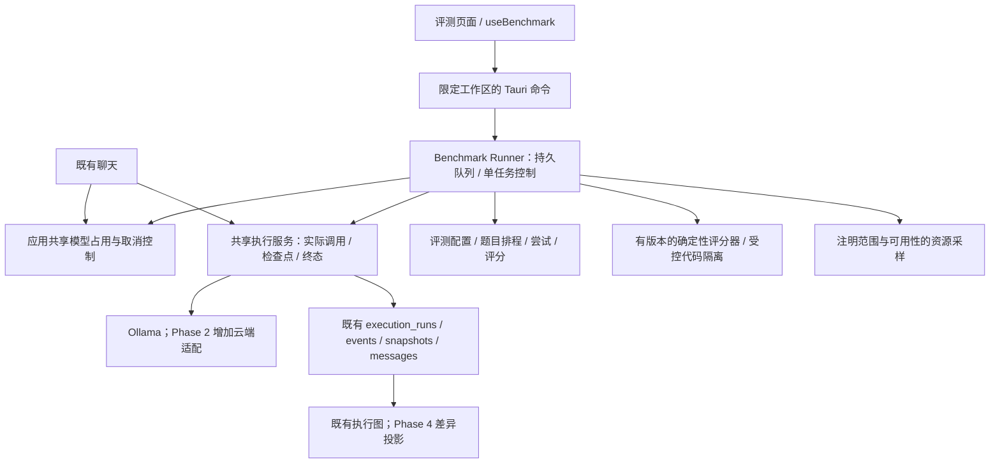

# Benchmark Studio 接入架构

2026-10-23 · 当前切片3已实现generation共享流执行、TaskSlot/Lease全应用占用、开发单题准备/执行/基础评分及专用详情/取消，见[实际契约](benchmark-execution-slice3.md)。下文仍包含完整阶段设计；批量排程、统一新Provider、评测UI和3D接入尚待后续切片。Phase 0证据见[产品审计](benchmark-prd.md)，新增表见[数据库方案](benchmark-database-schema.md)。保持React/Tauri/Rust/SQLite和现有3D引擎。

## 边界和复用方式

前端通过`invoke`和带任务ID的Channel交互；Rust承担模型、数据库、文件导出和未来凭据访问。保留CSP的IPC边界，不开放前端任意网络、SQL或shell能力。

### 执行记录的具体取舍

当前`0001_initial.sql`中的执行必须关联会话和回答消息，`db.rs:589`原子保存这组实体。推荐保留这些外键和不可变记录，给`conversations`增加`purpose='chat'|'benchmark'`，每次评测尝试使用一个专用会话，以`benchmark_attempts.execution_run_id`关联真实执行。

专用会话与当前工作区同域，但不会进入普通会话列表或历史上下文。`Database::conversations`、普通消息/改名/发送入口、聊天运行列表及深度链接都检查用途；评测详情和执行图使用明确的评测读取入口，按所属尝试校验。不能仅靠前端隐藏。新增字段默认chat，已有数据含义保持原样。共享底层读取供内部服务使用，聊天命令的用途检查留在业务边界，避免使执行图内部读取失效。

同时审计两个入口：`db.rs:292`创建会话是无列名INSERT，新增列前必须改为显式列名；`bootstrap.activeRun`和执行图“返回对话”当前默认聊天语义，须区分用途。保留activeRun的聊天兼容投影，增加有kind的activeTask摘要；评测执行图返回对应单题，而不是打开被隔离的内部会话。

Phase 1从`commands.rs::generate`提取一次性执行服务：输入已冻结请求、实际运行、取消接收器和更新回调；保留流解析、250ms输出检查点、终态事务及已有错误保护。聊天继续使用原准备逻辑；Benchmark新增独立请求准备入口，复用原子记录函数。首版评测可禁用历史、检索和聊天系统提示，不能直接调用`start_chat`然后临时改全局设置。

共享执行只结束当前模型请求；整项占用由聊天调用者或Benchmark Runner持有并释放。不能沿用每题结束即`state.clear(run_id)`的行为释放整个实验，使下一题与聊天发生竞态。

这比立即把全部执行表改成多态owner结构小；代价是要审核所有会话入口。若该方案未获确认，先停在接入决策，不能绕开外键另建一份冒称相同的执行事实。

## 任务调度与运行状态

`BenchmarkRun`代表实验；逻辑测试项由模型槽位×题目×重复序号×实验分组唯一标识；`Attempt`代表一次实际尝试。重试增加Attempt，每次发送新建ExecutionRun，旧输出和评分不覆盖。

| 状态 | 进入条件 | 后续动作 |
| --- | --- | --- |
| pending | 已保存配置与全部逻辑项，尚未占用模型 | 开始或取消 |
| running | 获得全应用占用、持久化启动事件 | 串行调度或取消 |
| completed | 所有计划项已终结且结果可读取 | 查看失败/不支持/跳过数量；不等于全部答对 |
| failed | 配置、存储或运行环境错误使实验无法继续 | 保留已有结果，修复后明确恢复或新建实验 |
| cancelled | 用户请求停止已完成，未完成项保留 | 用户可创建续跑尝试；不能后台自动重启 |
| interrupted | 应用退出/崩溃后发现未结束任务 | 明确展示已保存结果和手动继续入口 |

单题另有`unsupported`、`blocked`及`pending`等投影，用于表示能力或环境不满足；与运行失败、答错分别统计。状态名固定映射为“等待开始 / 进行中 / 已完成 / 失败 / 已停止 / 已中断”。

共享占用从当前`AppState.active`扩展为聊天或评测任务，评测在换模型和两题间也持续持有，占用内包含当前实际run及取消信号。取消评测不能只取消当前一题然后继续下一题。数据库唯一running执行索引保留；再用唯一running评测索引和事务认领逻辑项防止重复启动。同一UI多次点击或旧Channel回调不能重复发送。

应用关闭时取消整个任务，等待当前输出及实验终态保存；重启先运行现有`recover_interrupted`，再恢复评测状态映射。已完成且已评分项直接读取；输出已完成但评分未保存的项只重新评分，不再次调用模型。正在发送的未知结果记录为中断，Phase 2按付费风险处理，不静默重发。

## 一道题的数据流

1. 读取冻结的实验、题目版本、模型身份、模板和能力配置，检查工作区与剩余项。
2. 原子认领逻辑项、分配尝试ID。记录预检结果；能力不支持时不创建虚构模型请求。
3. 获得共享占用，完成实际模型切换和资源采样基线；这类操作有自己的真实事件，不伪装成推理步骤。
4. 构造纯模型或固定资料请求。事务保存专用会话、消息、ExecutionRun、精确wire body和清单，并将尝试关联run；提交失败不发送。
5. 用单调时钟标记请求、首个有效输出和结束，记录服务端返回指标、可见工具调用及原始文本。状态更新限频，数据库短事务不持锁等待网络。
6. 保存响应终态；评分器读取该不可变输出和标准规则，追加评分版本。评分错误单独记录，可离线重算。
7. 推送带experiment/case/attempt/seq的更新。页面重开从数据库恢复；通知只是加速呈现，不能作为唯一事实来源。
8. 用户从结果打开真实执行图或原始输入；最后按完整计划、覆盖率和失败分类计算比较视图。

输出仍存在`messages.content`，请求仍存在`context_snapshots`。工具参数和Provider终帧中原来没有保存的字段通过有版本的实际事件保存；控制响应大小并标明截断，不另存一份可能不一致的回答正文。首版流式输出沿用1MiB保护，达到上限的结果不能算成功作答。

## 本地资源与3D

- 固定全应用并发1，按模型分组执行，避免每题反复切换。启动检查`/api/ps`，展示将卸载的具体模型；只在用户本次明确同意后卸载已有无关模型。之后仅释放本任务加载的模型。
- 首版预加载使用不生成答案的本地模型管理操作，实际请求和确认结果记入benchmark_events；不把它当正式题。以后若引入问答式预热，必须作为独立实际执行记录，包含调用数量与可能费用。
- 卸载/预热/切换都可取消；卸载完成需实际确认。其他进程可能调用Ollama，检测到干扰则标记条件变化并暂停，不能承诺独占整机GPU。
- 采样默认1秒，后台有限队列和批量落库；时钟、间隔、缺样与采集开销写入报告。nvidia-smi不可用时GPU显示“不可用”，任务可继续。
- Windows CPU/RAM通过受限原生采集实现，分别标记应用进程、可确认的Ollama进程或整机范围。无法归因时不把整机显存冒充模型显存。
- 评测主页面不挂载3D画布；现有`GraphViewport.tsx:259`按需渲染继续复用。以后打开差异图再按需加载，保持相机可打断。对照实验固定是否显示3D及采样策略。

## Phase 3知识增强与Phase 4差异

生产知识的`effective_version`会变化，现有`prepare_context_run`还会拒绝非当前生效版本。因此A/B不能靠暂时修改生产指针。用户选定后，将知识正文、版本、来源行、检索语料和规则复制到不可变实验快照；基线A不带知识/历史，增强B只从这份快照检索，复用`retrieval.rs`分词/排序语义，在独立快照索引执行。

旧来源停用仍阻止新的使用；保留的历史结果可审计，再次外发需满足当前授权。新增“记忆”“压缩”“外部验证”只有真实实现并留下输入/输出时才成为可选实验因素，未实现功能显示未开放。

差异图复用`projectExecution`、GraphViewport和检查器。用`(case_id,repeat,arm)`对齐两次实验，用`(node_id,version,hash)`比较知识，用步骤种类/调用身份对齐实际事件，不能用两个实验不同的事件UUID直接匹配。缺少事件显示“未记录”，冲突须有明确事实或评分依据；生成文本不提供隐藏思维链。

## 预计修改点

| 现有位置 | 后续增量 |
| --- | --- |
| `src-tauri/src/commands.rs`、`lib.rs` | 共享占用和关闭控制；新增限定评测命令；提取实际执行，不重写知识引擎 |
| `src-tauri/src/db.rs`、`models.rs` | 用途隔离、可复用原子记录、评测独立配置类型与恢复顺序 |
| `src-tauri/src/ollama.rs` | 复用HTTP/NDJSON，补元数据/ps/释放和结构化字段，保持原聊天行为 |
| `src-tauri/build.rs`、`capabilities/default.json` | 只添加已实现业务命令，不增加通用shell/文件/网络权限 |
| 新`src-tauri/src/benchmark/{mod,repository,runner,evaluation,telemetry}.rs` | 按已有模块颗粒拆分；Provider云端实现到Phase 2再加 |
| 新`src/benchmark/{BenchmarkPage,ExperimentForm,RunMonitor,ResultsTable,CaseInspector,useBenchmark}.tsx/ts` | 局部评测状态；测试集/模型页面随对应切片建立 |
| `src/App.tsx`、`navigation.ts`、`components/AppShell.tsx`、`NavigationIcon.tsx` | 一个新入口及稳定深链，不把评测状态塞满useStudio |
| `src/styles/`现有语义Tokens | 补评测布局，复用菜单、固定头/正文/底部、Toast和主题 |

文件名是实施提案，不是已创建清单。Phase 0没有新增上述业务文件。
